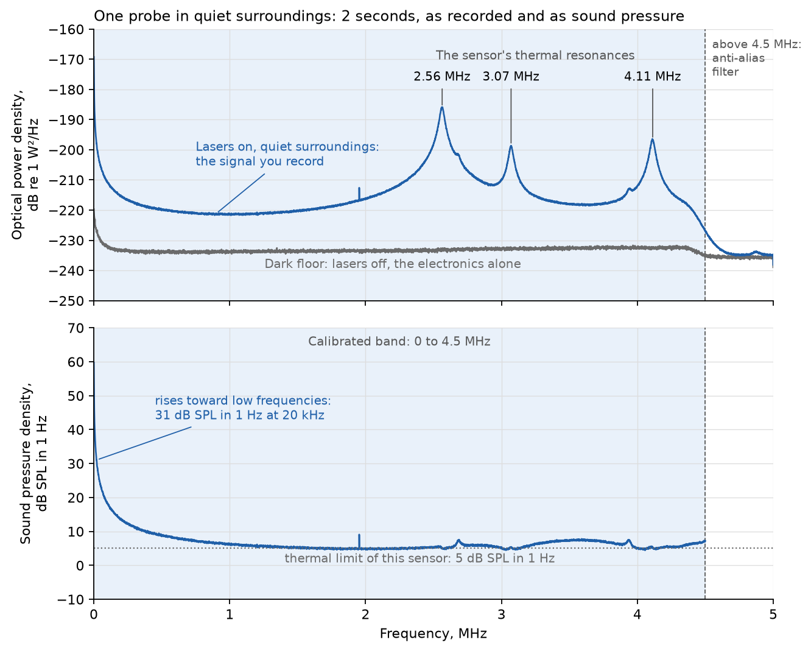

# Ultracoustics SDK

The Ultracoustics SDK is the Python interface to the BROADSONIC optical
ultrasound sensor. It lets a script do what the Ultracoustics GUI does: start
the instrument, capture and record its signal, convert that signal to sound
pressure, and monitor for changes. The GUI is itself built on this SDK, so a
script and the GUI produce the same results from the same hardware.

This page introduces the instrument and the ideas the SDK is built around, shows
a first script, and explains how the repository is organised. The remaining
documentation is listed under [Documentation](#documentation).

> **Laser safety.** The readout box contains two lasers, one of them invisible,
> and a script switches them on. Never look into the probe tip, a fiber end or
> an optical port, and never touch the probe's sensing face. Read the safety
> section of the
> [User Manual](https://ultracoustics.ca/assets/User%20Manual/BROADSONIC%20Optical%20Microphone%20User%20Manual.pdf)
> before connecting the probe.

## Background

A BROADSONIC system has two parts. The **probe** is an optical sensor on the end
of a fiber cable. The **readout box** contains the lasers, the detector and the
electronics, and connects to a computer by USB.

Sound moves the sensor at the probe tip, and the box measures that movement
with light. An infrared laser at 1550 nm is reflected from the sensor, and the
reflected light falls on a detector. Sound appears as small fluctuations in the
optical power the detector receives. A second laser, at 638 nm, is used by the
box to hold itself in tune with the sensor, so that the measurement stays at
the sensor's most sensitive point.

The box digitises the detector signal at 10 million samples per second and
streams it to the computer continuously. Everything after that happens in
software: the SDK receives the stream, checks it for lost data, converts it to
optical power and to sound pressure, and saves it.

The figure below is two seconds recorded from one probe in quiet surroundings.
The upper panel is the signal as recorded, in optical power. The lower panel is
the same data converted to sound pressure, and shows the quietest sound the
system can distinguish at each frequency.



The peaks are the sensor's own mechanical resonances, driven by thermal motion.
They are present in every recording and differ from probe to probe. The SDK
uses them as a built-in reference to calibrate sound pressure, which is why no
external reference source is needed. [How it works](docs/how_it_works.md)
explains the figure in detail.

## Key ideas

**The Controller.** One object, `uc.Controller`, represents the box. A script
connects to it, starts it, takes data and releases it. Only one program can use
the box at a time, so the GUI must be closed while a script runs.

**Start-up.** `ctrl.start_ready()` performs the whole start-up in one call, as
the START button does in the GUI. It takes a lasers-off reference, switches the
lasers on, waits for the box to settle on the sensor, checks the box's control
settings, and calibrates sound pressure. This takes about 30 seconds, during
which the probe should be still and the surroundings quiet.
`ctrl.start_ready(quick=True)` is ready in a few seconds but skips the checks
and the calibration.

**The dark and the background.** Two reference measurements make data usable.
The *dark* is the detector's signal with the lasers off, and `start_ready()`
takes it automatically. The *background* is what the probe picks up with the
source under study switched off. Only the user can take it, and subtracting it
is what separates a source from its surroundings.

**Pressure calibration.** The conversion from optical power to sound pressure
is measured at every start, from the sensor's thermal resonances. It belongs to
one probe and one start, and it is saved with every recording. Pressure values
are valid from 0 to 4.5 MHz.

**Checked data.** `ctrl.capture()` returns complete data or raises an error that
says what went wrong. It never returns data with samples missing. Long
recordings made with `ctrl.record()` go straight to disk and mark any loss in
the file.

**Units.** Data is stored as raw detector readings and converted on request:

| Quantity | Unit | Obtained with |
|---|---|---|
| Raw samples | ADC counts, 0 to 16383, at 10 MS/s | `rec.counts()` |
| Optical power | µW (one count is 0.00844 µW) | `rec.power_uw()` |
| Spectrum | W²/Hz | `rec.spectrum()` |
| Sound pressure spectrum | Pa²/Hz, or dB SPL in 1 Hz | `rec.calibration.to_pressure(spectrum)` |
| Level in a frequency band | dB SPL | `pressure.band_level(20e3, 100e3).spl_db` |

**When something is wrong.** `ctrl.self_test()` checks the whole system in about
six minutes and reports what it finds. It is the first step whenever the box
does not behave as expected. Error messages from the SDK say what to do next.

## A first script

```python
import ultracoustics as uc

def main():
    with uc.Controller() as ctrl:       # connects, and turns the lasers off at the end
        report = ctrl.start_ready()     # lasers on, ready and calibrated: about 30 s
        print(report.message)
        rec = ctrl.capture(1.0)         # one second of signal, checked for lost samples
        rec.save("first_capture")       # two files, .sigmf-data and .sigmf-meta; an existing name is never overwritten

if __name__ == "__main__":              # required: see Essentials
    main()
```

Saved recordings can be analysed later on any computer, without the box:

```python
import ultracoustics as uc

rec = uc.load_recording("first_capture.sigmf-meta")
spectrum = rec.spectrum()
pressure = rec.calibration.to_pressure(spectrum)
print(pressure.band_level(20e3, 100e3).spl_db, "dB SPL between 20 and 100 kHz")
```

Before relying on data from your own scripts, read
[Essentials](docs/essentials.md). It covers what the start-up report means, how
to take a background, file naming, what each error means, and what happens to
the lasers when a script ends.

## Using this repository

| Folder or file | Contents |
|---|---|
| `ultracoustics/` | The Python package. |
| `docs/` | The guides listed below. |
| `examples/` | Five short scripts. Three run on the sample recording in `examples/data` and need no box. |
| `AGENTS.md` | The rules and calls in a form written for an AI coding assistant. |
| `CHANGELOG.md` | What changed in each release. |

**Install.** Python 3.9 or later is required. In a terminal, in a copy of this
repository:

```bash
python3 -m venv .venv
source .venv/bin/activate
pip install .
```

On Windows the second line is `.venv\Scripts\activate`. On macOS, also run
`brew install libusb`. [Getting started](docs/getting_started.md#2-install-the-sdk)
gives the steps in detail, including Linux.

**Check the installation.** This runs on the sample recording and needs no box:

```bash
python examples/analyze_recording.py
```

**Suggested order.** Use the GUI first, to confirm that the box and probe work
and to see what a normal signal looks like. Then run `examples/capture.py`,
read [Essentials](docs/essentials.md), and adapt the examples to your
application.

## Documentation

| Page | Read it for |
|---|---|
| [Essentials](docs/essentials.md) | Everything to know before relying on the data: the start-up in full, the rules, units, what to do when something is wrong, common tasks. |
| [Getting started](docs/getting_started.md) | The slow walkthrough: setting up the box, installing step by step, the first script line by line, a glossary. |
| [How it works](docs/how_it_works.md) | What the box does and what your computer does, the USB stream, the start-up stages, what happens when a script ends. |
| [Analysis guide](docs/analysis_guide.md) | Counts to sound pressure, the three dB SPL numbers, removing noise, waveforms and tones. |
| [Saving data](docs/saving_data.md) | The files, their metadata, gaps, split files and events. |
| [Monitoring](docs/monitoring.md) | Triggers, baselines, alarms and events, the run folder, limits. |
| [Advanced control](docs/advanced_control.md) | The start-up one stage at a time, the box's control settings, the signal level, changing probes. |
| [Reference](docs/reference.md) | Every public name on one page. |
| [Updates](docs/UPDATES.md) | Checking for updates and installing firmware. |
| [Examples](examples) | Three that run on the sample recording with no box, and two that need one. |

Every public class and function has its own help: `help(uc.Controller.start_ready)`,
`help(uc.Recording)`.

**Using an AI assistant?** Point it at [AGENTS.md](AGENTS.md). It holds the
rules and the calls in a form written for a coding assistant.

The hardware's Quick Start Guide,
[User Manual](https://ultracoustics.ca/assets/User%20Manual/BROADSONIC%20Optical%20Microphone%20User%20Manual.pdf)
and [datasheet](https://ultracoustics.ca/assets/docs/UltracousticsBroadsonicDatasheet.pdf)
are at [ultracoustics.ca/downloads](https://ultracoustics.ca/downloads). For
support, write to Ultracoustics at
[ultracoustics.ca/contact](https://ultracoustics.ca/contact).

## What is supported

Use the names on `ultracoustics` itself, the methods of `Controller` and the
steps in `ultracoustics.updates`. **Do not use `ultracoustics._internal`, or
any name that starts with an underscore**, such as `ctrl._box`. That code can
drive the lasers and overwrite firmware without the checks the public calls
make, and a mistake there can leave the box needing service: see
[the reference](docs/reference.md#what-is-not-here). If something you need is
missing, ask Ultracoustics.

## Licence

The SDK is under the BSD 3-Clause licence: see [LICENSE](LICENSE). The Windows
`libusb-1.0.dll` it includes is libusb, under the GNU LGPL 2.1 or later: see
[THIRD_PARTY_NOTICES.md](THIRD_PARTY_NOTICES.md).
