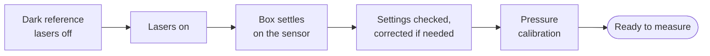
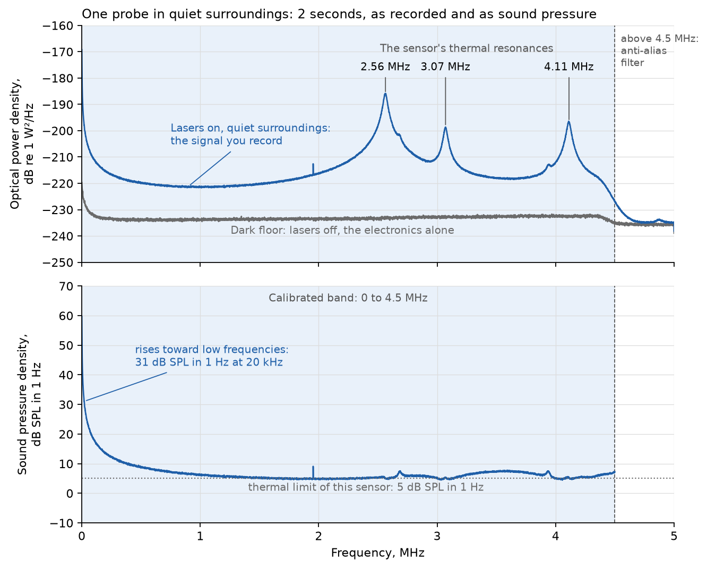

# Essentials

Everything a script writer must know, in full. The [README](../README.md) is the
short version of this page. Read this one before you rely on the data.

## The first script, in full

Close the GUI, then run this. It is all a script needs.

```python
import time
import ultracoustics as uc

def main():
    with uc.Controller() as ctrl:     # required: connects, and always turns the lasers off at the end
        report = ctrl.start_ready()   # required: lasers on and ready (about 30 s)
        if not report.calibrated:     # no new pressure calibration from this start: the message says why
            print(report.message)
        rec = ctrl.capture(1.0)       # one second of signal
        name = "capture_" + time.strftime("%Y%m%d_%H%M%S")    # a new name each run: nothing is overwritten
        print("saved", rec.save(name))                        # optional: name.sigmf-data and name.sigmf-meta

if __name__ == "__main__":            # required
    main()
```

`start_ready()` is the START button of the GUI. One call does the whole
start-up:



When it returns, the box is ready. `report.lock.ok` is `False` when its control
settings could not be checked, usually because the surroundings were too noisy.

Check `report.calibrated`. If it is `False`, this start made no pressure
calibration, and `report.message` says why. On a script's first start, data is
then in optical power only. On a later start, the earlier start's calibration
is still attached to new data: do not trust pressure values from it.
`ctrl.calibrate_pressure()`, with no arguments, tries again without restarting.

If the box cannot get ready at all, `start_ready()` raises `uc.StartError` with
what to do, and turns the lasers off. It usually says so within 90 seconds, or
after a few minutes if it was correcting the box's settings. The call prints
nothing while it runs.

Every capture is checked: `capture()` either gives you complete, trustworthy
data or raises `uc.CaptureError` that says why.

## What you must know

In order of importance.

1. **Try the GUI first.** Use the Ultracoustics GUI, from
   [ultracoustics.ca/downloads](https://ultracoustics.ca/downloads), to confirm
   the box and probe work and to see what a good signal looks like. Then close
   it: **only one program can use the box at a time.**
2. **Start with `ctrl.start_ready()`, and keep still while it runs.** Keep the
   probe still and the surroundings quiet until it returns, ideally with the
   thing you want to measure switched off. It takes about 30 seconds, and about
   a minute more when it corrects and stores the box's settings for your probe.
   It is refused while a recording or a monitor is running.
3. **`start_ready(quick=True)` is ready in a few seconds, and gives things up.**
   It skips every check: nothing is measured or corrected, the signal may still
   drift for the first seconds, and there is no new pressure calibration. Data
   is in optical power only (no Pa, no dB SPL), or carries an earlier start's
   calibration that must not be trusted. Use it for a quick look, not for data
   you will keep.
4. **Two reference measurements make data usable: the dark and the background.**
   - The **dark** is the detector's own signal with the lasers off. The pressure
     calibration needs it. `start_ready()` takes it for you.
   - The **background** is what the probe picks up with the thing you are
     measuring switched off. Only you can take it. Capture a few seconds of it
     after every `start_ready()` and subtract it: see
     [Remove the background](#remove-the-background). Without it, it is hard to
     tell your source from the room and the system's own noise.
5. **Keep `if __name__ == "__main__":`.** The SDK reads the USB in a second
   Python process, which loads your script again when it starts. Without that
   line your code runs twice, or fails at start.
6. **Plug the box straight into the computer.** Use a USB 2.0 High Speed port
   or faster, with a data cable and no hub. The stream is 20 MB every second,
   so a recording to disk grows by about 72 GB an hour.
7. **Nothing is overwritten.** Saving to a name that exists raises
   `FileExistsError`. Give every run a new name, for example with the date and
   time.
8. **The signal level is set by hand, once for each probe, and most probes
   never need it.** If the reflected light is too strong for the detector, the
   box cannot get ready, and `start_ready()` says so. Then run this yourself,
   once. Do not let a measurement script do it automatically: it changes a
   setting kept on the box.

   ```python
   level = ctrl.measure_signal_level()        # a few minutes. Changes nothing
   print(level.describe())                    # read it before you store
   stored = ctrl.store_signal_level(level)    # changes the setting kept on the box
   print(stored.verified)                     # True: the box came back at the new setting
   ```

   Both calls run the lasers and leave the box stopped, so call
   `start_ready()` again afterwards. `uc.SignalLevelError` means no setting
   fits this probe: contact Ultracoustics. In the GUI: Diagnostics > Adjust
   signal level. More in
   [Advanced control](advanced_control.md#the-signal-level).
9. **The lasers go off when the script ends, except after a forced kill.**
   After Task Manager's "End task", `kill -9` or a crash of Python, or when an
   error says a stop was not confirmed, the lasers may still be on: use the
   box's button or power switch. See
   [When the script ends](how_it_works.md#when-the-script-ends).
10. **Know your units.** The next section.

## Units

The signal arrives as raw detector readings. Everything else is computed from
them, on your computer.

| Quantity | Unit | How to get it |
|---|---|---|
| Raw samples | ADC counts: whole numbers from 0 to 16383 (14-bit), 10 million a second | `rec.counts()` |
| Optical power at the detector | µW. One count is 0.00844 µW, so full scale is about 138 µW | `rec.power_uw()`, or `uc.counts_to_uw(counts)` |
| Spectrum of the optical signal | W²/Hz (watts, not µW) | `spectrum = rec.spectrum()`, then `spectrum.psd_w2hz` |
| Spectrum in sound pressure | Pa²/Hz | `pressure = rec.calibration.to_pressure(spectrum)`, then `pressure.psd_pa2hz` |
| Density: noise and broadband sound | dB SPL in 1 Hz | `pressure.spl` |
| Band level: total sound in a band | dB SPL | `pressure.band_level(20e3, 100e3).spl_db` |
| Tone level: one steady tone | dB SPL | `uc.tone_level(rec, rec.calibration, 40e3).spl_db`. Needs `1.5 / bandwidth_hz` seconds of data: 0.15 s by default. The shipped sample is 0.1 s |

- Sound appears as small fluctuations on a steady optical power. The steady
  part is the light on the detector, not sound. It includes the detector's
  dark offset: with the lasers off `rec.power_uw()` still reads about 2 µW
  (about 240 counts). `rec.power_uw(baseline=240)` subtracts a level in counts.
- dB SPL is relative to 20 µPa. Density, band level and tone level are three
  different numbers for the same sound: the
  [analysis guide](analysis_guide.md#4-three-numbers-in-db-spl) says when
  to use which.
- Pressure units need the pressure calibration that `start_ready()` makes. They
  are valid from 0 to 4.5 MHz, the calibrated band.
- Files store the raw counts, with the calibration beside them.

This is two seconds from one probe in quiet surroundings. The peaks are the sensor's own resonances, driven by
thermal motion. They are always there, and the calibration is read from them.



## When something is wrong

**First, always: run the self-test and keep its report.** Do this for an error
you cannot explain, and equally when there is no error but the data does not
look right. It checks the whole system in about six minutes and says what is
wrong. The one exception is a message that the signal is too strong: that
names its own fix (item 8 above).

Keep the probe still and the surroundings quiet while it runs. It turns the
lasers on, stores nothing on the box, and leaves the box stopped. The GUI's
Diagnostics menu calls it Self-check.

```python
import time
import ultracoustics as uc

def main():
    with uc.Controller() as ctrl:
        report = ctrl.self_test()         # optional: probe_serial="the number on your probe", for the report
        print(report.text())
        name = "self_test_" + time.strftime("%Y%m%d_%H%M%S") + ".json"    # a new name each run
        print("saved", report.save(name))                                 # send this file to Ultracoustics

if __name__ == "__main__":
    main()
```

If the report does not settle it, send the saved file to Ultracoustics at
[ultracoustics.ca/contact](https://ultracoustics.ca/contact).

Problems that stop a script before the self-test can run:

| You see | Do this |
|---|---|
| `RuntimeError: Master Board not found` | No box on USB. Check the box is powered and the cable carries data. |
| `RuntimeError` saying the USB reader process could not open the device, or exited during start-up | Usually another program has the box: close the GUI and any other script using it. Or the `__main__` line is missing: put the script's work under `if __name__ == "__main__":`. |
| `uc.StartError` | Read its message: it says what to do. That is the self-test, or the signal level when the signal is too strong (item 8 above). |
| `uc.CaptureError` saying the box is not ready to measure | Before a start: run `ctrl.start_ready()`. After one: the probe moved or the signal was lost. `ctrl.stop()` returns why, if the box stopped itself. Then `start_ready()` again, and a new background. Run the self-test if it keeps happening. |
| `uc.CaptureError` about lost data, or the computer falling behind | Use a port without a hub and close other heavy programs. Save long runs with `ctrl.record()`. |
| `uc.CaptureError` saying no samples arrived for 2 s | The stream stopped. Check the cable and the box. |
| An error from `ctrl.stop()`, or a `RuntimeError` saying the shutdown was not confirmed | The lasers may still be on. Use the box's button or power switch. |
| `FileExistsError` | A file of that name exists. Choose a new name. |
| Windows shows BROADSONIC without a driver, or Linux says access denied | See [Getting started](getting_started.md#if-the-computer-cannot-open-the-box). |

`lock` in a message or a name means ready: the box holding itself in tune with
the sensor.

## Common tasks

Each snippet goes inside the `with uc.Controller() as ctrl:` block of the first
script, after `ctrl.start_ready()`, unless it says it needs no box.

### Record for a long time

```python
recorder = ctrl.record("long_run_" + time.strftime("%Y%m%d_%H%M%S"), duration_s=60)    # straight to disk, any length
print(recorder.samples, "samples saved,", recorder.lost, "lost,", recorder.dropped or "no", "USB drops,",
      recorder.not_ready_s, "s not ready")
```

Unlike `capture()`, `record()` does not raise when data is lost or the box
stops being ready. It marks the place in the file and carries on, so check
`recorder.lost`, `recorder.dropped` and `recorder.not_ready_s`. It raises
`uc.CaptureError` only if the box is not ready when it starts, or if no samples
arrive for 2 s.

See [Saving data](saving_data.md).

### Analyse a saved recording

This needs no box and no `__main__` line.

```python
import ultracoustics as uc

rec = uc.load_recording("capture_20261116_141500.sigmf-meta")    # the name your capture printed
spectrum = rec.spectrum(fft_size=16384)               # W²/Hz
pressure = rec.calibration.to_pressure(spectrum)      # Pa²/Hz
print(pressure.band_level(20e3, 100e3).spl_db, "dB SPL between 20 and 100 kHz")
```

See the [analysis guide](analysis_guide.md).

### Remove the background

```python
background = ctrl.capture(5.0).spectrum()           # your source switched off
input("Switch the source on, then press Enter")     # optional: any way of waiting will do
rec = ctrl.capture(5.0)                             # your source switched on
clean = rec.spectrum().subtract(background)         # what the source added
before = rec.calibration.to_pressure(rec.spectrum()).band_level(20e3, 100e3).spl_db
level = rec.calibration.to_pressure(clean).band_level(20e3, 100e3).spl_db   # dB SPL, 20 to 100 kHz
```

Always compare `level` with `before`. If the source adds nothing in that band,
`level` is a number well below `before` that means nothing: on the sample
recording, 50 against 63 dB SPL.

A Python warning that the optical power changed means the background (from
`subtract`) or the calibration (from `to_pressure`) no longer matches the data.
Retake both captures, after a new `start_ready()` if `to_pressure` warned.

`examples/remove_background.py` runs this on the sample recording. The
[analysis guide](analysis_guide.md#5-removing-noise) explains it.

### More

- **Watch a machine for changes:** `ctrl.monitor(...)`. See
  [Monitoring](monitoring.md).
- **Stop, and find out why the box stopped itself:** `fault = ctrl.stop()`.
  See [Advanced control](advanced_control.md#while-the-box-runs).
- **Check for updates:** `uc.check_for_updates()`, with no `Controller` open.
  See [Updates](UPDATES.md).
