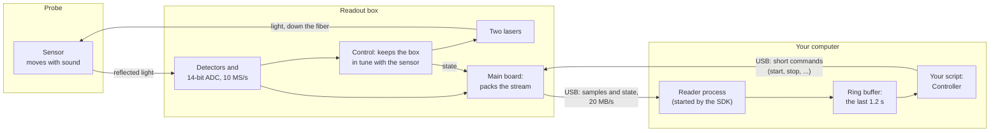
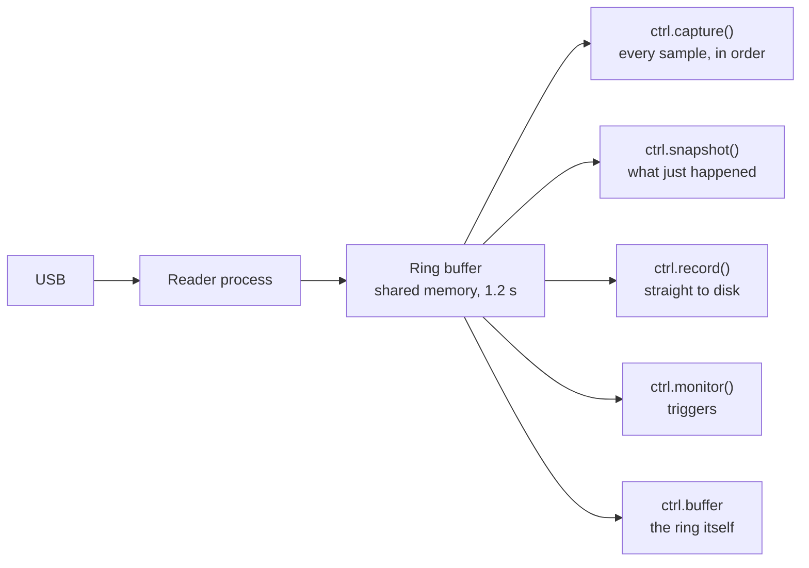
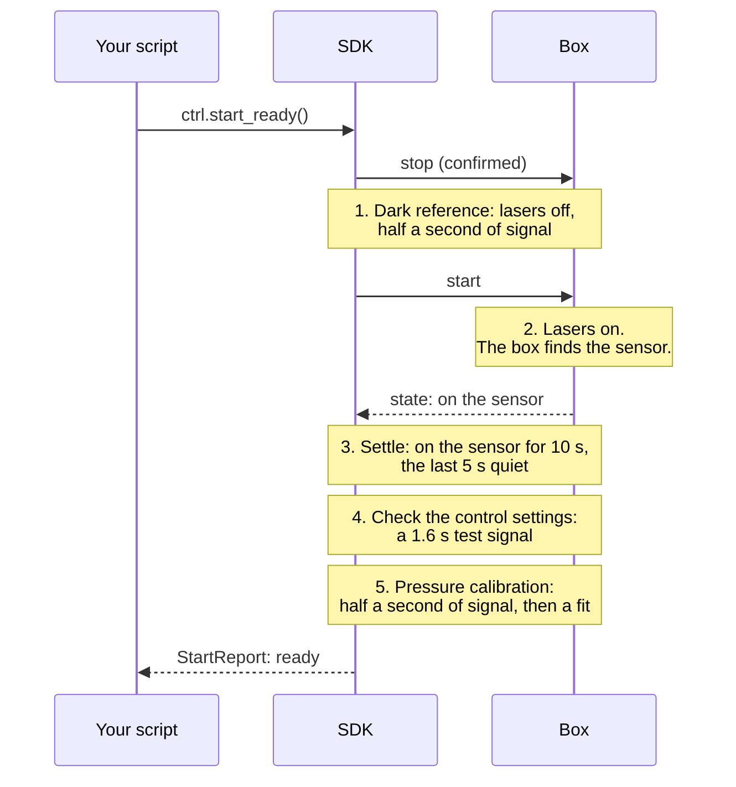
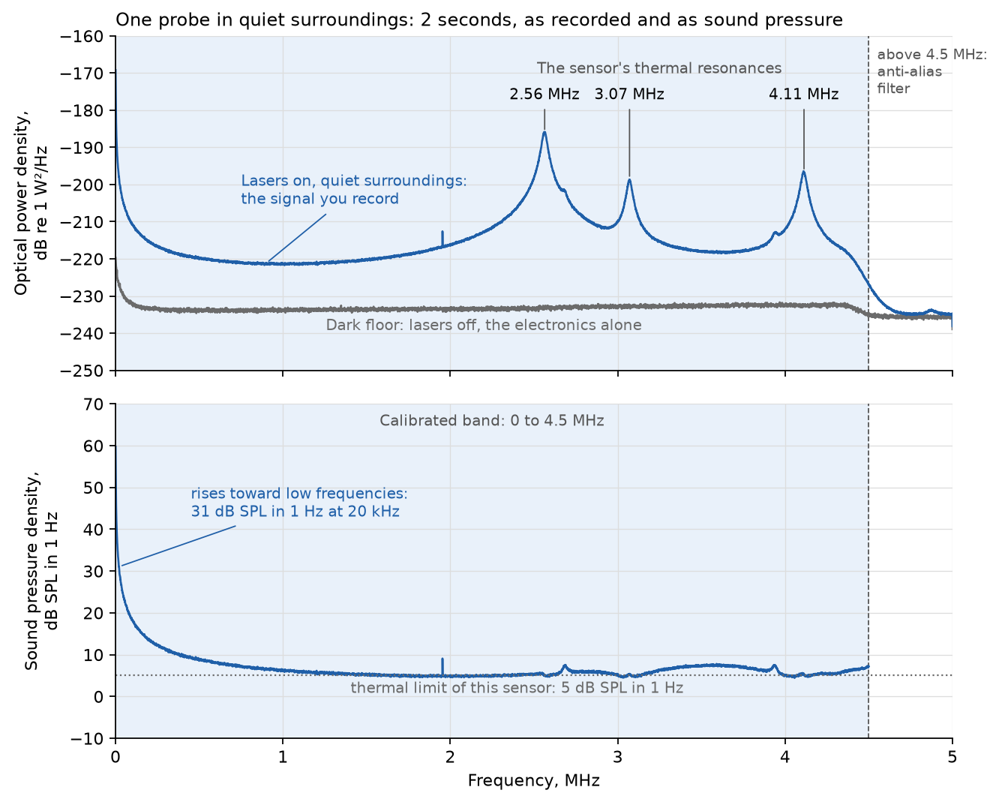
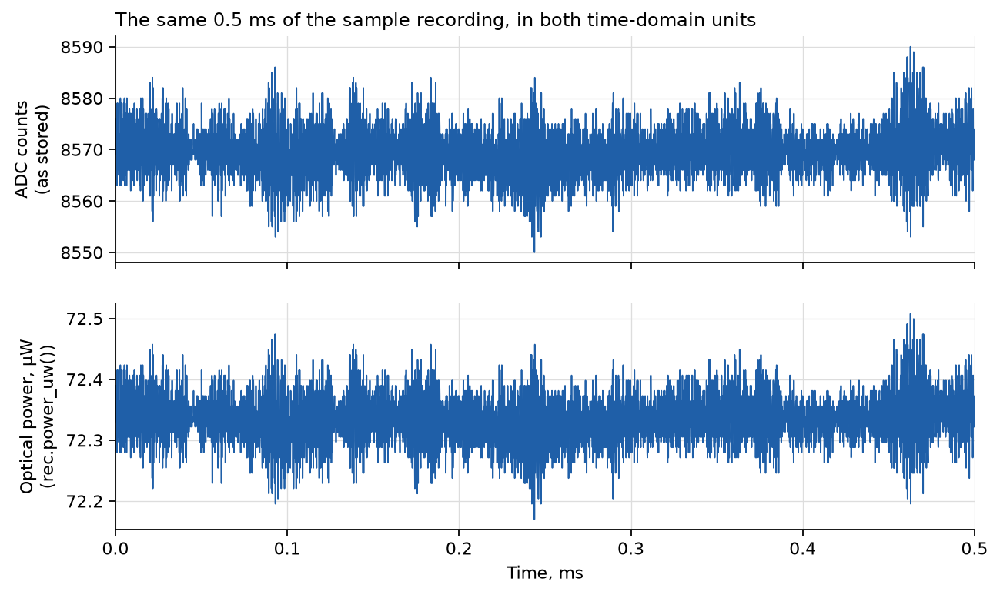

# How it works

What the readout box does by itself, what your computer does, and what travels
between them. You do not need this page to use the SDK. It is here so that the calls,
the errors and the numbers make sense.

**This page is for understanding, not for building on.** The supported
interface is the public API: the names on `ultracoustics` and the methods of
`Controller`. The USB format described below is not part of it. It changes with
firmware, and the SDK checks every packet in ways this page only outlines. Do
not read the USB device or send it commands yourself: see
[What is supported](../README.md#what-is-supported).

## The parts



Sound moves the sensor in the probe tip. The box shines laser light down the
fiber and measures the light that comes back, which changes as the sensor
moves. The detector's output, sampled 10 million times a second, is the signal.

## Who does what

| The box, by itself | Your computer, through the SDK |
|---|---|
| Drives the lasers and holds their temperatures | Decides when to start and stop |
| Keeps itself in tune with the sensor, with its own control loop | Waits until the box has settled, and checks its control settings from the signal |
| Samples the detector: 14-bit, 10 MS/s, behind a 4.5 MHz anti-alias filter | Reads the stream without losing any, and proves it |
| Numbers every packet it sends | Compares the numbers, to detect lost data |
| Reports its own state alongside the samples | Refuses to return data taken while the box was not ready |
| Stops itself on a fault, such as the probe signal being lost | Asks why it stopped: `ctrl.stop()` returns the fault |
| Keeps a few settings: the signal level and its control settings | Measures and stores those settings, when you ask |
| | Converts counts to µW, spectra and sound pressure |
| | Takes the dark reference and the pressure calibration |
| | Runs triggers and monitoring, and writes the files |

Two things follow from this split.

- **The box does no signal processing for you.** Everything after the raw
  counts happens on your computer, in code you can read. The files hold the raw
  counts, so any analysis can be redone later.
- **The computer has to keep up.** Triggering and recording run on the computer,
  not in the box. If it falls behind, samples are lost. They are always counted
  and reported, never skipped silently.

## What travels over USB

### From the box to the computer

One continuous stream of packets, about 1220 a second. Each packet carries
8192 samples, and the box's state rides in the same packet as the samples it
describes.

| Part of a packet | Size | Holds |
|---|---|---|
| Sequence number | 4 bytes | This packet's number. It goes up by one each packet. |
| Drop counter | 4 bytes | How many packets the box itself has had to discard, because its own queue was full. |
| Samples | 16 384 bytes | 8192 detector readings, each an unsigned 16-bit number with 14 bits used: 0 to 16383. |
| State | 140 bytes | The box's report of itself. Present once the SDK has asked for it. |

The state block holds two records and a checksum. One record is always the
1550 nm laser board's: its temperature and its internal photodiode reading,
each with its age and whether it is valid. The other is either the same for the
638 nm laser board, or a page of the state of the control loop that keeps the
box in tune with the sensor. The SDK asks for the control loop's page when it
starts the box, which is how it knows the box is ready.

```text
 one packet (16 532 bytes with state)
+----------+----------+--------------------------------------+---------------------+
| sequence | drops    | 8192 samples, 2 bytes each           | state               |
| number   | counter  | (ADC counts, 0 to 16383)             | lasers, temperatures|
| 4 bytes  | 4 bytes  | 16 384 bytes                         | readiness, checksum |
+----------+----------+--------------------------------------+---------------------+
```

The samples are the 20 MB a second: 10 million samples of 2 bytes each.

### How lost data is detected

- **A gap in the sequence numbers** means packets went missing between the box
  and the SDK.
- **The drop counter rising** means the box discarded packets itself.
- **A failed or malformed USB transfer** is counted by the reader.

The public view of these is `ctrl.stream_stats`, and `ctrl.status.stream_drops`
holds the loss counters. You rarely need to look. `ctrl.capture()` compares
them before and after, and raises `uc.CaptureError` if anything was lost.
`ctrl.record()` keeps going and reports the loss in its result and in the file:
see [Saving data](saving_data.md#gaps).

### How the SDK knows the box is ready

The state arrives with the samples. If none has arrived for 500 ms, the SDK
treats what it has as stale and no longer counts the box as ready. So "ready"
always means "the box said so, just now". The API calls this state the lock:
`ctrl.locked`, and the `require_lock` option of `capture()`, `record()` and
`monitor()`.

In a script, `ctrl.telemetry` is the newest state and `ctrl.status` sums up the
box and the stream.

### From the computer to the box

Short commands: start, stop, standby, a request for state, and the few that
read or store a setting. How much each public call confirms differs:

| Call | What it confirms |
|---|---|
| `ctrl.stop()` | Waits for the box to report it is stopped, and raises if it does not. |
| `ctrl.start()` | Confirms the command was delivered. It returns before the box is ready: `ctrl.start_ready()` waits for that. |
| `ctrl.warm()` | Nothing. The command is sent without waiting for an answer. |
| The calls that store a setting | Read the setting back from the box. |

The commands are not documented, on purpose. Some of them drive the lasers or
write the box's stored settings, and the public calls make checks first that a
raw command would skip.

## On the computer



- **The reader is a second Python process.** It does nothing but take packets
  off the USB, so a busy script cannot make it lose data. Python starts it by
  loading your script again, which is why a script must keep its work under
  `if __name__ == "__main__":`.
- **The reader holds the USB device.** This is why only one program can use the
  box at a time.
- **The ring buffer** holds the newest 1.2 seconds of samples, 20 MB for each
  second, and is overwritten continuously. `uc.Controller(ring_seconds=...)`
  makes it longer. A snapshot or a monitor's event can use the ring less
  0.2 s: about 1.0 s by default.
- **The stream starts when you connect**, before the lasers are on.
  `ctrl.samples_received` counts every sample since then.
- **`capture()` and `record()` follow the ring in order**, by sample number, so
  nothing is skipped or repeated. If they fall a whole ring behind, the loss is
  counted and reported.

## Start-up

`ctrl.start_ready()` runs these stages. The box runs its lasers and its
control loop on its own. The SDK watches, measures and decides.



| Stage | What happens | How long |
|---|---|---|
| 1. Dark reference | With the lasers off, half a second of the detector's own signal is captured. The pressure calibration needs it. | About a second |
| 2. Lasers on | The box powers its lasers and brings itself onto the sensor. | Set by the box |
| 3. Settle | The SDK waits until the box has stayed on the sensor for 10 s, with the last 5 s quiet. | 10 s or more. It gives up after 90 s. |
| 4. Check | The SDK adds a small 1.6 s test signal and reads the response, to confirm the box's control settings suit this probe. | A few seconds |
| 4b. Correct, only when needed | New settings are applied, verified and stored on the box, and the box is restarted on them. | About a minute |
| 5. Pressure calibration | Half a second of signal is captured and the sensor's thermal resonances are fitted. | About a second |

In all, about 30 seconds. Stages 3 to 5 measure the probe itself, which is why
it must be still and its surroundings quiet.

`ctrl.start_ready(quick=True)` runs stage 2 only, then waits for the box to
report it is on the sensor: a few seconds. If that has not happened after 30 s
it raises `uc.StartError`. There is no dark, no settling wait, no check and no
new pressure calibration. A box that is already running and ready is left
alone. One that is running but not ready, because it stopped itself or is in
standby after `ctrl.warm()`, is restarted.

**When a start fails.** Every failure of `start_ready()` is a `uc.StartError`,
including a command the box did not answer. The lasers are turned off first.
If that stop could not be confirmed, the message says the lasers may still be
on. A failure usually shows within 90 seconds, or after a few minutes if stage
4b was running. `err.signal_too_strong` is `True` when the cause is the signal
level, and `err.detail` holds the technical reason, for support. Ctrl-C during
the call turns the lasers off too. An exception raised by your own `progress`
or `cancel` function stops the box and is raised again as itself.

**When only part of it fails.** The box is still ready, and the report says
what is missing:

- `report.lock.ok` is `False` when stage 4 could not check the control
  settings, usually because the surroundings were too noisy.
- `report.calibrated` is `False` when stage 5 failed, and `report.message` says
  why. On a script's first start, data is then in optical power only. On a
  later start, the earlier start's calibration is still attached to new data:
  do not trust pressure values from it. `ctrl.calibrate_pressure()`, with no
  arguments, tries again on the same dark reference without restarting.

To run the stages one at a time, see [Advanced control](advanced_control.md).

## When the script ends

The lasers stay on until something turns them off. The SDK turns them off
whenever Python gets the chance to run its exit steps.

| How the script ends | The lasers |
|---|---|
| The `with` block ends, or `ctrl.close()` is called | Off, confirmed. If the stop could not be confirmed, a `RuntimeError` says the lasers may still be on. |
| The script finishes, raises an error or calls `sys.exit()`, with no `with` and no `close()` | Off. The SDK stops the box as Python exits. |
| Ctrl-C | Off: by the `with` block, or else as Python exits. |
| A plain `kill` (SIGTERM), as from `docker stop` or a service manager | Off, if the script installed no SIGTERM handler of its own and connected from its main thread. With your own handler, off only if it lets Python exit normally. |
| A forced kill: Task Manager's "End task", `kill -9`, `os._exit()`, a crash of Python itself, the computer losing power | **On.** Nothing can run. The lasers stay on until you use the box's button or power switch. |

Two more cases:

- If the box's answer to START is lost, the SDK still counts the box as
  started, so leaving the `with` block sends STOP.
- If a stop cannot be confirmed, in `ctrl.stop()`, in `ctrl.close()` or after a
  failed `start_ready()`, the error says the lasers may still be on. Use the
  box's button or power switch.

For a script that runs unattended, use `with`, and do not rely on the exit
steps alone: a stop made as Python exits reports nothing if it fails.

## The sensor's resonances

The sensor is a tiny mechanical structure, and like any such structure it has
resonances: frequencies at which it moves most easily. Two things drive it.

- **Sound**, which is what you want to measure.
- **Its own thermal motion**, which is always there. The size of this
  thermomechanical motion is set by physics alone, so it serves as a built-in
  reference: the pressure calibration is read from it.

This is two seconds from one probe in quiet surroundings.



**Upper panel: optical power.**

- The peaks are the sensor's thermal resonances. On this probe the calibration
  fitted them at 2.56, 3.07 and 4.11 MHz. These values are for this probe.
  Each probe has its own: read yours from the calibration,
  starting with `rec.calibration.fundamental.f0_hz`.
- The grey line is the dark floor: the electronics alone, with the lasers off.
  The signal sits above it across the band, so the electronics are not what
  limits this measurement.
- The signal rises steadily toward low frequencies.
- A narrow line that is not at a fitted resonance, like the small one just
  below 2 MHz here, is not a sensor resonance, and the calibration does not
  treat it as one.
- Above 4.5 MHz the anti-alias filter cuts the signal off. Pressure values are
  given up to there: 0 to 4.5 MHz is the calibrated band.

**Lower panel: the same spectrum as sound pressure.**

- With nothing to hear, this is the noise floor: the quietest sound that can be
  told from the system's own noise at each frequency.
- It is lowest around the resonances, where it reaches the sensor's thermal
  limit, the dotted line: 5 dB SPL in 1 Hz on this probe.
- It rises steeply toward low frequencies, at the left edge of the plot: about
  18 dB SPL in 1 Hz at 100 kHz, 37 at 10 kHz and 57 at 1.2 kHz in this
  recording.

The [analysis guide](analysis_guide.md) shows how to get each of these numbers
from a recording, and how to remove noise.

## The same signal in counts and in µW



The two traces are the same data. Counts are what the box sends and what the
files store. µW is counts times 0.00844. The steady level, about 72 µW here, is
the light on the detector. Sound, and noise, are the small movements on top of
it.
